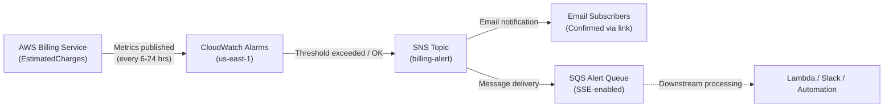

# 🚀 AWS Billing Alert Terraform Module  

  

Welcome to the **AWS Billing Alert Terraform module!** This module provisions automated CloudWatch billing alarms, an SNS notification topic, email subscriptions, and an optional SQS queue for programmatic cost alerts. Once configured, you will receive real-time notifications whenever your AWS account charges exceed your specified budget thresholds. 💰  

---

## 🛠️ Prerequisites  

> [!IMPORTANT]
> **Before deploying, ensure you have completed the following:**
>
> 1. 🧰 **Terraform (v1.5.0 or later)** installed on your machine.
> 2. 🌐 **Enable Billing Alerts in AWS Console**: In the AWS Billing & Cost Management console, navigate to **Billing Preferences** and enable **"Receive Billing Alerts"**. (CloudWatch `EstimatedCharges` metric data is not generated until this preference is turned on).
> 3. 🗺️ **Region Requirement (`us-east-1`)**: AWS CloudWatch Billing metrics (`AWS/Billing`) are **exclusively published to the `us-east-1` (US East, N. Virginia) region**. All CloudWatch billing alarms and their associated SNS topic must be configured in `us-east-1`.
> 4. 🔑 **AWS Credentials**: AWS CLI or IAM credentials with permissions for CloudWatch, SNS, SQS, and CloudWatch Logs.

---

## 🔍 Architecture & How It Works  



1. **AWS Billing Metrics**: AWS calculates charges and publishes the `EstimatedCharges` metric to the `AWS/Billing` namespace in `us-east-1` approximately every 6 to 24 hours.
2. **CloudWatch Alarms**: Alarms evaluate `Maximum` charges against your customized thresholds (both total account charges and individual per-service charges).
3. **Amazon SNS**: When an alarm triggers or recovers, it securely publishes a notification to the encrypted SNS topic.
4. **Email Subscriptions**: Configured email addresses receive the alert. Each recipient receives an initial AWS confirmation email with a link they must click to activate notifications.
5. **SQS Queue Endpoint**: An optional SQS queue with SQS-managed Server-Side Encryption (SSE) and strict access controls enables automated downstream processing (e.g. Lambda, ticketing, or ChatOps).

---

## 🛡️ Security & Enterprise Enhancements

- 🔒 **Least-Privilege SNS Policy**: Restricts `sns:Publish` to CloudWatch Alarms from your specific AWS account ID and region, completely preventing Confused Deputy attacks.
- 🚫 **No Public Wildcards**: Removed open `Principal = "*"` subscribe permissions to prevent unauthorized external subscriptions to your billing alerts.
- 🔐 **Confused Deputy Protection on SQS**: SQS queue policy strictly enforces `aws:SourceArn` matching the billing SNS topic ARN.
- 🛡️ **Encryption at Rest**: SQS queue has `sqs_managed_sse_enabled = true` and SNS topic supports KMS encryption via `kms_master_key_id`.
- 🔁 **Deterministic Resource Management (`for_each`)**: Alarms and email subscriptions use `for_each` rather than list indices (`count`), preventing accidental resource churn and subscription invalidation when modifying lists.
- 🎯 **Dynamic Per-Service Monitoring**: Monitor any AWS service (e.g., `AmazonEC2`, `AmazonRDS`, `AmazonS3`, `AWSLambda`) or set `services_to_monitor = []` to only track total charges.

---

## 📦 Setup & Deployment Instructions  

### 1️⃣ Clone the Repository  

```bash  
git clone https://github.com/NotHarshhaa/aws-billing-alert-terraform.git  
cd aws-billing-alert-terraform  
```  

### 2️⃣ Initialize Terraform  

```bash  
terraform init  
```  

### 3️⃣ Configure Variables  

Copy the provided example variable file:  

```bash
cp terraform.tfvars.example terraform.tfvars
```

Edit `terraform.tfvars` with your settings:  

```hcl  
# AWS Region (Must be us-east-1 for AWS Billing metrics)
aws_region = "us-east-1"

# Billing thresholds in your selected currency
alert_thresholds = [50, 100, 200]

# Services to monitor individually (leave empty [] for total charges only)
services_to_monitor = ["AmazonEC2", "AmazonRDS"]

# Email addresses to receive alerts
email_endpoints = [
  "devops@example.com",
  "finance@example.com"
]

# Currency for billing alerts (3-letter ISO code)
currency = "USD"

# Evaluation period in seconds (21600 = 6 hours, 86400 = 24 hours)
alarm_period = 21600

# Enable OK / recovery notifications
enable_ok_actions = true

# Create SQS queue for downstream automation
enable_sqs_endpoint = true

# Environment tag
environment_tag = "Production"
```  

### 4️⃣ Plan and Apply  

```bash  
terraform plan  
terraform apply  
```  

> [!IMPORTANT]
> **Email Confirmation**: After running `terraform apply`, AWS SNS will send a verification email with the subject *"AWS Notification - Subscription Confirmation"* to each email address. Each recipient **must click the "Confirm subscription" link** in the email to begin receiving billing alerts.

---

## 📝 Module Usage (as a Reusable Module)  

You can also use this repository as a child module inside your existing Terraform code:  

```hcl  
module "billing_alert" {  
  source              = "github.com/NotHarshhaa/aws-billing-alert-terraform"  
  aws_region          = "us-east-1"  
  alert_thresholds    = [100, 250, 500]  
  services_to_monitor = ["AmazonEC2", "AmazonS3"]  
  email_endpoints     = ["ops-team@example.com"]  
  currency            = "USD"  
  alarm_period        = 21600  
  enable_ok_actions   = true  
  environment_tag     = "Production"  
  tags = {
    CostCenter = "Infrastructure"
    ManagedBy  = "Terraform"
  }
}  
```  

---

## ⚙️ Input Variables  

| Variable | Description | Type | Default | Required |
|:---|:---|:---:|:---:|:---:|
| `aws_region` | AWS region for billing alerts (validated to `us-east-1`) | `string` | `"us-east-1"` | No |
| `alert_thresholds` | List of billing thresholds to trigger total charge alarms | `list(number)` | `[100, 150, 200]` | No |
| `services_to_monitor` | AWS service names to monitor individually (e.g. `["AmazonEC2"]`) | `list(string)` | `["AmazonEC2"]` | No |
| `service_alert_thresholds` | Custom thresholds for service alarms (uses `alert_thresholds` if null) | `list(number)` | `null` | No |
| `email_endpoints` | List of valid email addresses to receive alert notifications | `list(string)` | `[]` | No |
| `currency` | 3-letter ISO currency code (e.g. `USD`, `EUR`, `GBP`) | `string` | `"USD"` | No |
| `alarm_period` | CloudWatch metric evaluation period in seconds (`21600`, `43200`, `86400`) | `number` | `21600` | No |
| `enable_ok_actions` | Send SNS notification when alarm transitions back to OK | `bool` | `true` | No |
| `enable_sqs_endpoint` | Create an SQS queue subscribed to SNS topic for downstream apps | `bool` | `true` | No |
| `enable_custom_billing_logs` | Create `/aws/billing` CloudWatch log group & metric filter | `bool` | `false` | No |
| `kms_master_key_id` | KMS Key ID/ARN/alias for SNS server-side encryption | `string` | `null` | No |
| `sns_topic_name` | Name of the SNS topic for billing alerts | `string` | `"billing-alert"` | No |
| `environment_tag` | Environment tag value (e.g. `Production`, `Staging`) | `string` | `"Production"` | No |
| `tags` | Additional map of custom tags to apply to all resources | `map(string)` | `{}` | No |

---

## 📊 Module Outputs  

| Output | Description |
|:---|:---|
| `sns_topic_arn` | ARN of the SNS topic created for billing alerts |
| `sns_topic_name` | Name of the SNS topic |
| `cloudwatch_alarm_names` | List of alarm names for total account charges |
| `cloudwatch_alarm_arns` | List of alarm ARNs for total account charges |
| `service_alarm_names` | List of alarm names for per-service charges |
| `service_alarm_arns` | List of alarm ARNs for per-service charges |
| `sns_dlq_arn` | ARN of the SQS alert queue (if enabled) |
| `sns_dlq_url` | URL of the SQS alert queue (if enabled) |
| `email_endpoints` | List of configured recipient email addresses |
| `email_subscription_count` | Number of email subscriptions configured |
| `configuration_summary` | Map summarizing the deployed billing alert configuration |

---

## ❓ Frequently Asked Questions (FAQ)  

<details>
<summary><b>Why do all billing alarms have to be created in us-east-1?</b></summary>
AWS generates consolidated billing metrics globally and posts them specifically to the CloudWatch <code>AWS/Billing</code> namespace in the <code>us-east-1</code> (N. Virginia) region. Alarms created in other regions will show <code>INSUFFICIENT_DATA</code> or no metrics. Additionally, CloudWatch Alarms can only send notifications to SNS topics in the same region.
</details>

<details>
<summary><b>Why hasn't the alarm triggered immediately after exceeding the threshold?</b></summary>
AWS Billing metric data is calculated and updated in CloudWatch roughly every 6 to 24 hours, rather than in real time. Once the updated metric point is published and crosses your threshold, CloudWatch triggers the alarm immediately.
</details>

<details>
<summary><b>Why didn't I receive an alert email?</b></summary>
Check if you clicked the confirmation link in the confirmation email sent by AWS SNS. Look in your Spam/Junk folder for an email from <code>no-reply@sns.amazonaws.com</code> with the subject <i>"AWS Notification - Subscription Confirmation"</i>.
</details>

---

## 🤝 Feedback and Contributions  

> [!TIP]  
> _We'd love to hear your thoughts! Whether it's feedback, bug reports, or pull requests, feel free to get involved. Your contributions help make this module better for everyone._  

## ⭐ Hit the Star  

> [!IMPORTANT]  
> _If you find this repository helpful for learning or in practice, **please hit the star button on GitHub.** ⭐ It helps others find this resource too!_  

### 👤 Author  

  

> [!TIP]  
> **Join Our [Telegram Community](https://t.me/prodevopsguy) || [Follow me on GitHub](https://github.com/NotHarshhaa) for more DevOps content!**  
